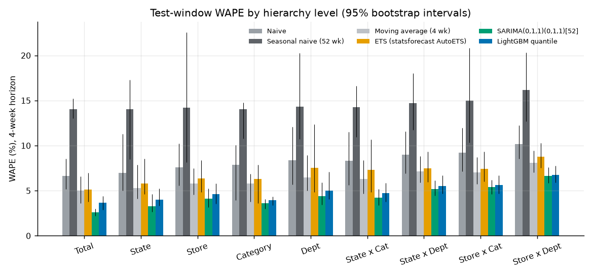
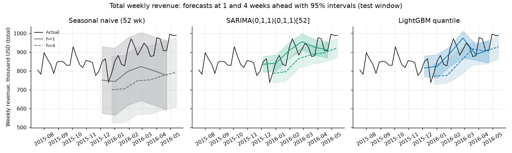
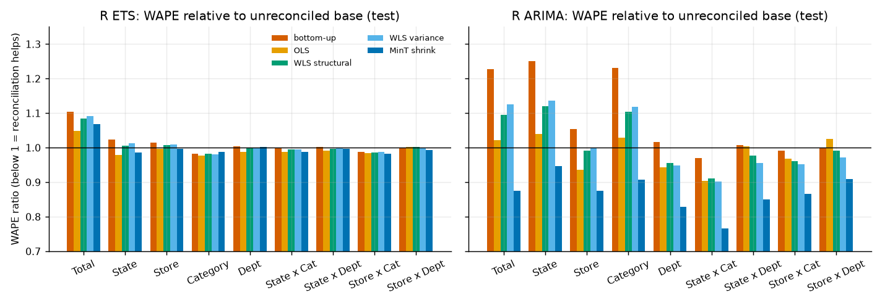
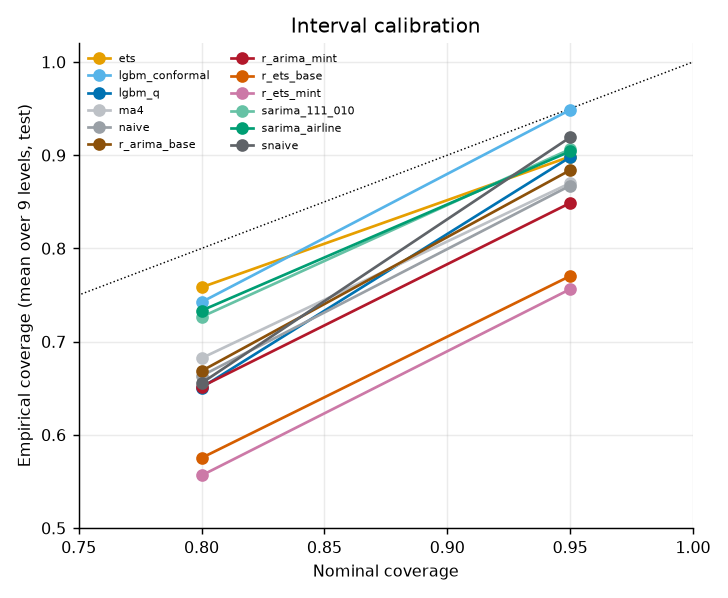

# Retail Revenue Forecasting - Using hierarchical reconciliation and quantile gradient boosting to produce probabilistic revenue forecasts across US Walmart stores and departments

**Outcome.** On the final 24 held-out weeks of M5 Walmart revenue (4-week horizon, 6 origins), fixed-order seasonal ARIMA models give the lowest
total-revenue WAPE (2.6%, versus 5.0% for a 4-week moving average and 14.0% for seasonal naive), MinT-reconciled fable ARIMA is the most accurate
at 8 of the other 8 hierarchy levels in WAPE (3.2% to 6.3%), a plain 4-week moving average beats statsforecast ETS in WAPE at all 9 levels, and the
fable ARIMA intervals after bottom-up, OLS or WLS reconciliation under-cover badly (80% intervals cover 17% to 29% of actuals at the Total level).

Tableau dashboard: [Hierarchical Revenue Forecasting, M5](https://public.tableau.com/app/profile/abhishek.thakur1845/viz/HierarchicalRevenueForecastingM5/M5ForecastDashboard) (a 5-sheet dashboard built from the flattened CSVs in `tableau/web/`; the fuller design is in `tableau/DASHBOARD_SPEC.md`).

## Business question

How accurate and decision-useful are 4-week-ahead revenue forecasts across stores, departments and the total business, and does forcing
forecasts to add up across the hierarchy (reconciliation) make them better? "Decision-useful" is judged by calibrated 80 and 95 percent
intervals and by the safety buffer a planner would carry.

## Data

M5 Forecasting (Walmart): 30,490 item-store series (59,181,090 item-store-day cells, 1,941 days from 2011-01-29 to **2016-05-22**), 3,049
items, 7 departments, 3 categories, 10 stores in CA, TX and WI, calendar with events and SNAP days, 6,841,121 weekly price rows.
Source: Nixtla public GitHub copy of the competition files (no Kaggle login), cross-checked cell for cell against a Hugging Face mirror;
URL, SHA-256 and shape checks in [`data/README.md`](data/README.md). **Licence:** no standalone open licence; competition rules
(described as non-commercial, academic research and education use). Raw files are never committed; only derived aggregates are.

Revenue is units x weekly sell price. Weekly series (277 complete Saturday-to-Friday weeks) are modelled; the 2 trailing days are dropped.
Cleaning counts (all computed in `sql/06_quality_and_daily.sql`, `artifacts/cleaning_log.csv`):
40,241,819 zero-unit cells (68.0%) kept as true zeros; 12,384,870 of them are
before an item-store's first sale; 1,757,059 item-store-weeks have no listed price (not on sale, revenue 0);
0 weeks have units without a price; 1,598,875 listed weeks had zero sales; 86,453 runs of 4 or more zero weeks with a
listed price (stockout or delisting proxy, 1,038,312 weeks, kept); 24 store-days with zero units in every item (closed
stores, Christmas); 2 days dropped (partial last week).

## Scope

* **Aggregated levels, complete:** M5 levels 1-9 (Total 1, State 3, Store 10, Category 3, Department 7, State x Category 9, State x Department 21,
  Store x Category 30, Store x Department 70) = **154 series**, summing exactly from the 70 bottom series (DECIMAL arithmetic, coherence
  proven by data-contract tests).
* **Item layer, sampled:** level 10 top **300 items** and level 12 top **600 item x store series**, chosen by revenue in weeks 1-197 only
  (before the first backtest origin, so no future information picks the series). They cover 44.3% (items) and
  21.4% (item x store) of selection-window revenue. This layer is **not coherent** with the 154-series
  hierarchy, is not reconciled, and gets ETS and LightGBM plus baselines only (SARIMA was not run there for compute reasons). Levels 11 and the other 2,749 items are not modelled.
* **Weekly, not daily:** weekly revenue is smoother, the 52-week season fits annual patterns, and 154 nodes x 20 refits stay tractable. A daily
  view of the last 12 weeks (levels 1-3) is exported for context only.

## Method

* **SQL (DuckDB, single thread):** long format, calendar and price joins, weekly fact, hierarchy bridge (summing matrix), two independent
  aggregation paths that must be identical, item-layer selection, cleaning log.
* **Backtest:** expanding window, 20 rolling origins every 4 weeks, horizon 4 weeks (28 days). Burn-in origins 197-225 (8, training and
  conformal calibration only), **validation** 229-249 (6), **final test 253-273 (6, weeks 254-277, defined up front, used for no choice)**. No random
  splits. Models are refit at every origin with data up to that origin.
* **Models:** naive, seasonal naive (52), 4-week moving average (Gaussian intervals from in-sample residuals); statsforecast AutoETS and two
  fixed-order SARIMA ([52] season); LightGBM, one global model per quantile (0.025, 0.1, 0.5, 0.9, 0.975), 250 trees, trained on the last 156 weeks before each origin, direct multi-horizon with horizon as a
  feature, target scaled by the trailing 52-week mean, lags, rolling means, SNAP days (node-weighted by state mix), events, week of year, price index; split-conformal intervals
  around the LightGBM median from earlier origins. R fable: STL + ETS and dynamic harmonic regression ARIMA (4 Fourier pairs, period 52) on all 154
  nodes, 12 origins (validation + test); reconciliation by bottom-up, OLS, WLS structural, WLS variance, MinT shrink; top-down (forecast and average proportions) on the strict 84-node geographic
  sub-hierarchy. Python numpy reconciliation of point forecasts for every Python model (error covariance from the model's own earlier backtest errors).
* **Metrics** (one code path for all models, including R): WAPE, MASE, RMSSE, bias, scaled pinball over 5 quantiles, coverage and width at 80 and
  95 percent. 95 percent bootstrap intervals over series (over origins for the single Total node), paired against seasonal naive or the unreconciled base.

## Results (final test window, weeks 254-277, horizon 4)

Bold = lowest per level. WAPE (%), lower is better:

| model | Total | State | Store | Category | Dept | State x Cat | State x Dept | Store x Cat | Store x Dept |
|---|---|---|---|---|---|---|---|---|---|
| Naive | 6.66 | 6.95 | 7.58 | 7.86 | 8.37 | 8.34 | 8.99 | 9.19 | 10.15 |
| Seasonal naive (52 wk) | 14.04 | 14.04 | 14.18 | 14.04 | 14.32 | 14.26 | 14.71 | 14.98 | 16.17 |
| Moving average (4 wk) | 5.03 | 5.31 | 5.8 | 5.79 | 6.49 | 6.32 | 7.17 | 7.02 | 8.1 |
| ETS (statsforecast AutoETS) | 5.14 | 5.81 | 6.34 | 6.32 | 7.53 | 7.32 | 7.5 | 7.42 | 8.78 |
| SARIMA(1,1,1)(0,1,0)[52] | **2.56** | 3.45 | 4.47 | 3.98 | 4.67 | 4.72 | 5.63 | 5.94 | 7.17 |
| SARIMA(0,1,1)(0,1,1)[52] | 2.59 | 3.28 | 4.11 | 3.62 | 4.38 | 4.23 | 5.2 | 5.38 | 6.66 |
| LightGBM quantile | 3.69 | 4.01 | 4.61 | 3.93 | 5.0 | 4.73 | 5.5 | 5.62 | 6.73 |
| LightGBM + conformal | 3.69 | 4.01 | 4.61 | 3.93 | 5.0 | 4.73 | 5.5 | 5.62 | 6.73 |
| R fable ETS base | 3.26 | 3.92 | 4.64 | 4.52 | 5.14 | 5.02 | 5.79 | 6.0 | 7.04 |
| R fable ARIMA base | 3.06 | 3.41 | 4.56 | 3.63 | 4.78 | 5.22 | 5.64 | 6.03 | 6.97 |
| R fable ARIMA MinT shrink | 2.67 | **3.23** | **3.99** | **3.3** | **3.96** | **4.0** | **4.8** | **5.23** | **6.33** |

MASE (scaled by one-step in-sample naive error), lower is better:

| model | Total | State | Store | Category | Dept | State x Cat | State x Dept | Store x Cat | Store x Dept |
|---|---|---|---|---|---|---|---|---|---|
| Naive | 1.58 | 1.51 | 1.64 | 1.61 | 1.63 | 1.49 | 1.54 | 1.55 | 1.56 |
| Seasonal naive (52 wk) | 3.34 | 3.04 | 3.78 | 3.65 | 2.84 | 3.15 | 2.49 | 3.22 | 2.8 |
| Moving average (4 wk) | 1.2 | 1.16 | 1.26 | 1.34 | 1.46 | 1.29 | 1.38 | 1.26 | 1.34 |
| ETS (statsforecast AutoETS) | 1.22 | 1.27 | 1.39 | 1.36 | 1.45 | 1.3 | 1.31 | 1.31 | 1.38 |
| SARIMA(1,1,1)(0,1,0)[52] | **0.61** | 0.76 | 1.08 | 1.09 | 1.07 | 1.14 | 1.13 | 1.24 | 1.27 |
| SARIMA(0,1,1)(0,1,1)[52] | 0.61 | **0.72** | **0.98** | 0.94 | **1.0** | **0.94** | 1.04 | **1.08** | 1.16 |
| LightGBM quantile | 0.88 | 0.89 | 1.07 | 1.03 | 1.22 | 1.08 | 1.14 | 1.15 | 1.21 |
| LightGBM + conformal | 0.88 | 0.89 | 1.07 | 1.03 | 1.22 | 1.08 | 1.14 | 1.15 | 1.21 |
| R fable ETS base | 0.77 | 0.85 | 1.07 | 0.99 | 1.12 | 0.97 | 1.1 | 1.12 | 1.18 |
| R fable ARIMA base | 0.73 | 0.76 | 1.07 | 1.03 | 1.2 | 1.05 | 1.1 | 1.15 | 1.2 |
| R fable ARIMA MinT shrink | 0.64 | 0.72 | 0.98 | **0.9** | 1.03 | 0.94 | **1.02** | 1.09 | **1.15** |

Scaled pinball loss (% of revenue), lower is better:

| model | Total | State | Store | Category | Dept | State x Cat | State x Dept | Store x Cat | Store x Dept |
|---|---|---|---|---|---|---|---|---|---|
| Naive | 1.32 | 1.46 | 1.77 | 1.56 | 1.72 | 1.74 | 1.94 | 2.08 | 2.32 |
| Seasonal naive (52 wk) | 2.47 | 2.64 | 3.26 | 2.75 | 2.98 | 2.83 | 3.08 | 3.51 | 3.8 |
| Moving average (4 wk) | 1.06 | 1.15 | 1.31 | 1.27 | 1.47 | 1.41 | 1.63 | 1.59 | 1.86 |
| ETS (statsforecast AutoETS) | 1.16 | 1.23 | 1.45 | 1.34 | 1.71 | 1.79 | 1.7 | 1.68 | 2.02 |
| SARIMA(1,1,1)(0,1,0)[52] | 0.57 | 0.72 | 1.07 | 0.82 | 0.99 | 0.99 | 1.22 | 1.34 | 1.63 |
| SARIMA(0,1,1)(0,1,1)[52] | **0.56** | **0.69** | **0.98** | 0.75 | 0.96 | **0.9** | 1.15 | **1.22** | 1.52 |
| LightGBM quantile | 0.76 | 0.84 | 1.04 | 0.84 | 1.1 | 1.02 | 1.27 | 1.28 | 1.55 |
| LightGBM + conformal | 0.72 | 0.86 | 1.07 | 0.82 | 1.17 | 1.06 | 1.34 | 1.35 | 1.67 |
| R fable ETS base | 0.8 | 0.97 | 1.14 | 1.12 | 1.24 | 1.21 | 1.4 | 1.44 | 1.67 |
| R fable ARIMA base | 0.62 | 0.76 | 1.09 | 0.74 | 1.08 | 1.17 | 1.3 | 1.41 | 1.66 |
| R fable ARIMA MinT shrink | 0.57 | 0.72 | 0.98 | **0.71** | **0.88** | 0.91 | **1.11** | 1.24 | **1.51** |

Empirical coverage of the 95% intervals (%, nominal 95; bold = closest to nominal):

| model | Total | State | Store | Category | Dept | State x Cat | State x Dept | Store x Cat | Store x Dept |
|---|---|---|---|---|---|---|---|---|---|
| Naive | 87.5 | 84.7 | 85.8 | 84.7 | 86.9 | 87.0 | 88.1 | 87.2 | 88.6 |
| Seasonal naive (52 wk) | **95.8** | 91.7 | 89.2 | **93.1** | 88.7 | **94.9** | 91.5 | 91.8 | 90.7 |
| Moving average (4 wk) | 87.5 | 88.9 | 88.3 | 86.1 | 83.9 | 87.0 | 86.3 | 88.1 | 86.9 |
| ETS (statsforecast AutoETS) | 83.3 | 91.7 | 91.2 | 90.3 | 88.7 | 88.9 | 92.1 | 91.2 | 91.2 |
| SARIMA(1,1,1)(0,1,0)[52] | 87.5 | 90.3 | 90.8 | 91.7 | 90.5 | 90.3 | 92.3 | 91.4 | 91.1 |
| SARIMA(0,1,1)(0,1,1)[52] | 87.5 | 90.3 | 91.2 | 91.7 | 89.9 | 90.7 | 89.9 | 92.2 | 90.3 |
| LightGBM quantile | 95.8 | 86.1 | 89.2 | 90.3 | 86.9 | 90.3 | 87.5 | 91.9 | 90.1 |
| LightGBM + conformal | 91.7 | **97.2** | **93.3** | 100.0 | **93.5** | 96.3 | **93.5** | **93.9** | **94.5** |
| R fable ETS base | 66.7 | 70.8 | 82.1 | 75.0 | 73.8 | 79.6 | 79.4 | 83.1 | 82.9 |
| R fable ARIMA base | 91.7 | 88.9 | 88.8 | 90.3 | 86.3 | 87.5 | 87.1 | 87.6 | 87.4 |
| R fable ARIMA MinT shrink | 87.5 | 83.3 | 86.2 | 84.7 | 84.5 | 81.5 | 85.7 | 84.9 | 85.5 |

Empirical coverage of the 80% intervals (%, nominal 80; bold = closest):

| model | Total | State | Store | Category | Dept | State x Cat | State x Dept | Store x Cat | Store x Dept |
|---|---|---|---|---|---|---|---|---|---|
| Naive | 54.2 | 66.7 | 69.6 | 62.5 | 66.7 | 67.1 | 70.8 | 68.3 | 71.1 |
| Seasonal naive (52 wk) | 37.5 | 58.3 | **77.1** | 62.5 | 66.1 | 67.1 | 69.0 | **77.5** | 74.8 |
| Moving average (4 wk) | 62.5 | 62.5 | 69.2 | 69.4 | 67.3 | 69.4 | 71.2 | 71.9 | 70.5 |
| ETS (statsforecast AutoETS) | **83.3** | 66.7 | 74.6 | **75.0** | 75.0 | 74.5 | **79.4** | 77.2 | 76.8 |
| SARIMA(1,1,1)(0,1,0)[52] | 70.8 | **73.6** | 73.8 | 63.9 | 76.2 | 70.8 | 74.8 | 73.9 | 76.1 |
| SARIMA(0,1,1)(0,1,1)[52] | 75.0 | 73.6 | 74.6 | 68.1 | 75.6 | 70.8 | 72.2 | 75.3 | 74.8 |
| LightGBM quantile | 50.0 | 58.3 | 64.6 | 63.9 | 63.7 | 71.3 | 69.4 | 71.0 | 73.5 |
| LightGBM + conformal | 62.5 | 69.4 | 73.8 | 75.0 | **77.4** | **78.7** | 76.8 | 77.4 | **77.3** |
| R fable ETS base | 45.8 | 50.0 | 60.8 | 54.2 | 57.1 | 59.7 | 62.3 | 63.6 | 64.1 |
| R fable ARIMA base | 54.2 | 70.8 | 72.1 | 59.7 | 66.7 | 68.1 | 71.4 | 67.9 | 70.8 |
| R fable ARIMA MinT shrink | 70.8 | 61.1 | 67.9 | 56.9 | 65.5 | 61.1 | 67.3 | 66.8 | 69.1 |

Item layer, test WAPE (%): models with the lowest value per column are the most accurate.

| model | Item (top 300 sample) | Item x Store (top 600 sample) |
|---|---|---|
| ETS (statsforecast AutoETS) | 18.7 | 27.6 |
| LightGBM + conformal | 17.4 | 26.1 |
| LightGBM quantile | 17.4 | 26.1 |
| Moving average (4 wk) | 20.0 | 28.6 |
| Naive | 20.0 | 29.7 |
| Seasonal naive (52 wk) | 37.8 | 53.6 |

### Reconciliation (R fable, test window): WAPE ratio vs unreconciled base, below 1 = better

| base_model | method | Total | State | Store | Category | Dept | State x Cat | State x Dept | Store x Cat | Store x Dept |
|---|---|---|---|---|---|---|---|---|---|---|
| R ARIMA | MinT shrink | 0.875 | 0.947 | 0.875 | 0.907 | 0.829 | 0.767 | 0.851 | 0.867 | 0.908 |
| R ARIMA | OLS | 1.021 | 1.039 | 0.936 | 1.028 | 0.943 | 0.904 | 1.005 | 0.968 | 1.026 |
| R ARIMA | WLS structural | 1.095 | 1.12 | 0.991 | 1.105 | 0.955 | 0.911 | 0.977 | 0.962 | 0.992 |
| R ARIMA | WLS variance | 1.125 | 1.137 | 1.001 | 1.118 | 0.949 | 0.901 | 0.955 | 0.953 | 0.971 |
| R ARIMA | bottom-up | 1.227 | 1.25 | 1.055 | 1.232 | 1.016 | 0.97 | 1.007 | 0.991 | 1.0 |
| R ETS | MinT shrink | 1.069 | 0.987 | 0.996 | 0.987 | 1.003 | 0.987 | 0.998 | 0.982 | 0.993 |
| R ETS | OLS | 1.048 | 0.979 | 0.997 | 0.976 | 0.988 | 0.988 | 0.992 | 0.983 | 1.003 |
| R ETS | WLS structural | 1.085 | 1.006 | 1.008 | 0.983 | 0.999 | 0.996 | 0.997 | 0.987 | 1.002 |
| R ETS | WLS variance | 1.091 | 1.012 | 1.01 | 0.98 | 1.0 | 0.994 | 0.998 | 0.988 | 0.999 |
| R ETS | bottom-up | 1.103 | 1.024 | 1.015 | 0.983 | 1.004 | 0.998 | 1.002 | 0.988 | 1.0 |

Top-down on the 84-node geographic hierarchy:

| base_model | method | Total | State | Store | Store x Dept |
|---|---|---|---|---|---|
| R ARIMA | MinT shrink | 1.048 | 1.025 | 0.893 | 0.924 |
| R ARIMA | OLS | 0.999 | 1.011 | 0.921 | 1.03 |
| R ARIMA | bottom-up | 1.227 | 1.25 | 1.055 | 1.0 |
| R ARIMA | top-down (average proportions) | 1.0 | 1.634 | 2.462 | 2.396 |
| R ARIMA | top-down (forecast proportions) | 1.0 | 1.02 | 0.927 | 0.964 |
| R ETS | MinT shrink | 1.068 | 0.992 | 1.0 | 0.993 |
| R ETS | OLS | 1.022 | 0.962 | 0.988 | 0.997 |
| R ETS | bottom-up | 1.103 | 1.024 | 1.015 | 1.0 |
| R ETS | top-down (average proportions) | 1.0 | 1.366 | 2.38 | 2.359 |
| R ETS | top-down (forecast proportions) | 1.0 | 0.961 | 0.987 | 0.991 |

### Residual tests (R fable, fit at the last test origin): share of nodes with Ljung-Box (lag 52) p < 0.05

| model | Total | State | Store | Category | Dept | State x Cat | State x Dept | Store x Cat | Store x Dept |
|---|---|---|---|---|---|---|---|---|---|
| arima | 1.0 | 1.0 | 0.9 | 1.0 | 1.0 | 0.89 | 0.9 | 0.7 | 0.83 |
| ets | 1.0 | 0.67 | 0.7 | 0.33 | 0.57 | 0.56 | 0.67 | 0.63 | 0.66 |

### Reconciliation, Python models (test window, WAPE ratio vs base)

Naive, seasonal naive and the moving average are linear and already coherent, so reconciliation leaves them unchanged (ratio exactly 1.000). For the others the
changes are small and mixed: SARIMA ratios stay within 0.96 to 1.05; ETS MinT is worse at the top (1.12 at Total) and better at departments (0.92);
LightGBM improves at the top (bottom-up 0.85 and MinT 0.89 at Total) with almost no change below State. Full tables:
`tableau/data/reconciliation_comparison.csv`.

### Reading the results

* **Where baselines win or tie:** seasonal naive is the worst model at every level (the 52-week lag carries a year of noise and ignores growth). The 4-week moving
  average beats statsforecast AutoETS in WAPE at all 9 levels (for example Dept 6.49% vs 7.53%) and has lower pinball loss at all 9 levels, so AutoETS with a 52-week season
  adds nothing here. Against seasonal naive, ETS and the moving average both reduce WAPE to about 0.36 to 0.45 of seasonal naive at levels 1-3, and their bootstrap intervals overlap.
* **Best point forecasts:** SARIMA(1,1,1)(0,1,0)[52] has the lowest Total WAPE (2.56%); R ARIMA with MinT is a close second at Total (2.67%) and lowest at levels 2-9. SARIMA(0,1,1)(0,1,1)[52] has
  the lowest MASE and pinball at several levels. Gaps between the best two or three models are small relative to the per-origin and bootstrap spread
  (`ci_lo`/`ci_hi`, `wape_origin_min`/`max` in `metric_scorecard.csv`); only 6 test origins exist, so treat the ranking among the top models as tentative. At the item layer LightGBM (17.4% item,
  26.1% item x store) beats ETS (18.7%, 27.6%) and the moving average (20.0%, 28.6%).
* **Reconciliation (R fable):** MinT shrink improves ARIMA at every level (WAPE ratio 0.77 to 0.95) but does little for ETS (ratios 0.98 to 1.07, worse at Total). Bottom-up
  makes ARIMA 23% worse at Total, 25% at State. OLS and WLS are mixed. Top-down with average proportions is 1.4x to 2.5x worse than base at State, Store and Store x Dept; forecast proportions are neutral to slightly better below Total (0.93 to 1.02 for ARIMA).
* **Intervals:** at 95% nominal, statsforecast SARIMA and ETS cover about 84 to 92% and fable ARIMA base 86 to 92%; quantile LightGBM covers 86 to 96% and
  under-covers at 80% (50 to 74%); split-conformal LightGBM is closest to nominal at levels 2-9 (93 to 97% at 95%, 69 to 79% at 80%, excluding Category) but over-covers Category (100%). Coverage at Total rests on 24 forecasts only
  and is noisy. **Reconciled fable intervals under-cover severely at aggregate levels** for bottom-up, OLS and both WLS methods (80% coverage 17% to 29% at Total and 19% to 42% at State for ARIMA); MinT shrink is the best of them
  (57% to 71% at 80%, 82% to 88% at 95%) and sits below the unreconciled ARIMA base at most levels below Total. Do not use those reconciled intervals for planning at upper levels.
* **Residuals:** the Ljung-Box test (lag 52, fit at the last test origin) rejects whiteness at 70% to 100% of ARIMA nodes by level and 33% to 100% of ETS nodes, so residual autocorrelation remains and the Gaussian intervals are
  mis-specified; with 277 weekly points and lag 52 the test is also demanding.

## Planning use (ASSUMED parameters)

`tableau/data/decision_planning.csv` and `decision_sensitivity.csv` compare planning at the point forecast with planning at the 90th percentile forecast (ASSUMED service level)
under **ASSUMED** costs: 25% margin lost per revenue dollar of unmet demand and 5% carrying cost per dollar of excess plan (4-week horizon). These are scenario
inputs, not estimates from M5. See `docs/planning_memo.pdf`.

## Limitations

M5 is 2011-2016 data from 10 Walmart stores in three states, so conclusions about hierarchy size, seasonality and SNAP effects may not transfer. Revenue uses list weekly
prices (no promotions or discounts beyond price changes), zeros mix true no-demand and stockouts, so revenue is censored demand. The test window is 6 origins x 4 weeks (24 weeks): rankings
between close models are fragile. SARIMA orders are fixed, not searched, and AutoETS was run with a 52-week season (which may hurt it). The item layer is a sample, uncoordinated and without SARIMA. The R and Python
base models differ, so R-versus-Python comparisons mix model and implementation. The sales file ends 2016-05-22 (1,941 days); the competition's final 28 days were never public in the files used.

## Reproduce

```bash
make setup            # python 3.11 venv, pinned deps (R 4.5: install fable, fabletools, feasts, tsibble, dplyr, tidyr, furrr, jsonlite, readr, ggplot2, knitr; versions in R/sessionInfo.txt)
make data             # download M5 files from public mirrors, verify shapes (about 360 MB)
make sql backtest r evaluate export figures     # about 45 minutes on 8 cores (Python backtest about 25 min, R about 13 min, run concurrently)
make report           # Quarto HTML (reports/), memo PDF, README
make test             # ruff + pytest on the committed fixture (no raw data needed)
python scripts/check_determinism.py snapshot artifacts/output_hashes.json
```

Determinism: DuckDB single thread, fixed seeds, explicit orderings; two complete runs of the real pipeline (SQL, Python backtest, R, evaluate, export; run B started from scratch) produced identical SHA-256 for 31 of 32 hashed files, covering the raw forecast tables, the R outputs and every Tableau CSV except one. The one difference, `hierarchy_nodes.csv`, came from a revenue-share denominator bug that I fixed between the two runs; re-running only the export step twice on unchanged inputs then gave identical hashes for all 32 files. The hash list is committed
(see `artifacts/output_hashes.json`).

## Repository layout

`sql/` numbered DuckDB scripts, `src/hier_forecast/` package, `R/forecast_reconciliation.R`, `reports/forecast_report.qmd` (+ rendered HTML), `tableau/data/` extracts and
`tableau/DASHBOARD_SPEC.md`, `tableau/web/` (5 flattened CSVs for Tableau Public web authoring, `make tableau-web`), `docs/` (data dictionary, memo, figures), `tests/` (fixture, data contracts, leakage, metrics, reconciliation, exports, determinism).

## Tableau extracts

| file | rows | MB |
|---|---|---|
| actuals_daily_recent.csv | 1,176 | 0.06 |
| actuals_weekly.csv | 42,658 | 2.13 |
| calendar_weeks.csv | 277 | 0.02 |
| cleaning_log.csv | 24 | 0.00 |
| coherence_gap.csv | 171 | 0.01 |
| decision_planning.csv | 2,310 | 0.55 |
| decision_sensitivity.csv | 3,645 | 0.47 |
| forecast_vs_actual.csv | 55,440 | 11.42 |
| hierarchy_nodes.csv | 1,054 | 0.16 |
| interval_coverage.csv | 928 | 0.15 |
| interval_coverage_by_horizon.csv | 4,376 | 0.44 |
| metric_scorecard.csv | 10,940 | 1.94 |
| metrics_by_origin.csv | 6,564 | 1.20 |
| origins_design.csv | 20 | 0.00 |
| reconciliation_comparison.csv | 10,680 | 1.70 |
| residual_diagnostics_nodes.csv | 308 | 0.03 |
| residual_diagnostics_summary.csv | 18 | 0.00 |

## Figures





